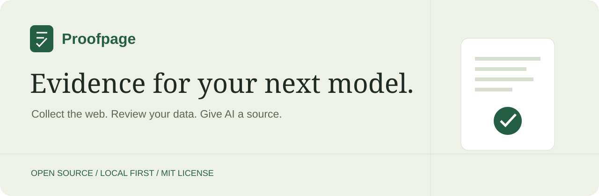
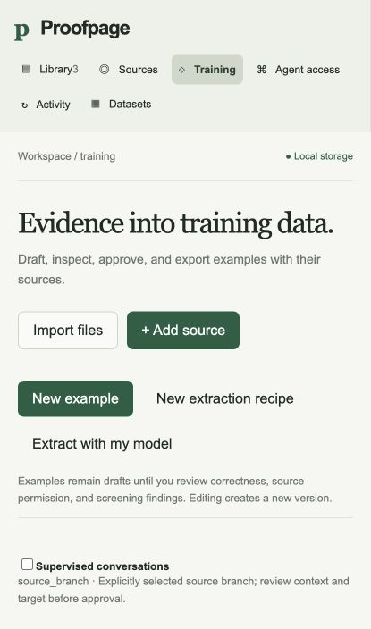

<p align="center"></p>

<p align="center">
<a href="https://github.com/Mehxeo/Proofpage-OpenSource/releases/tag/v0.1.3">Download</a> ·
<a href="#install-and-run">Install & run</a> ·
<a href="docs/CLI.md">CLI guide</a> ·
<a href="docs/TRAINING_AND_AGENTS.md">Training & agents</a> ·
<a href="CONTRIBUTING.md">Contribute</a>
</p>

Proofpage turns public web pages and your own exported files into **traceable evidence for AI**. Collect material, inspect the original source, review training examples, and export datasets—or let an existing AI assistant search your evidence through MCP.

**Free to run on your own computer. MIT licensed. No account, subscription, or model API key required for core features.** Desktop downloads include Python: no Python installation or terminal is needed. This is an early release. The Mac downloads are Developer ID signed and Apple-notarized; Windows signing is still pending.



## What you can do

| Your goal | Proofpage gives you |
| --- | --- |
| Collect useful web content | Public page capture, bounded crawling, refresh schedules, and original evidence |
| Bring your own data | ZIP, CSV, JSON, JSONL, Markdown, text, and HTML imports; conversation-aware adapters |
| Prepare training data | Reviewed SFT examples, preference pairs, corrections, evaluations, grouped splits, and frozen exports |
| Give your existing AI sources | MCP tools, cited search results, exact quotes, revision IDs, and capture timestamps |
| Stay in control | Local SQLite storage, permission reviews, backups, and portable exports |

Proofpage **prepares data; it does not train a model**. Collection respects robots rules and does not bypass logins or access controls. Optional model-assisted drafting sends selected content only when you request it and still requires review. See [capabilities and limits](docs/IMPLEMENTATION_STATUS.md).

## Install and run

### Download, extract, open

Choose your computer from the [v0.1.3 downloads](https://github.com/Mehxeo/Proofpage-OpenSource/releases/tag/v0.1.3):

| Computer | Download | Open it |
| --- | --- | --- |
| Mac with Apple silicon (M1 or newer) | **Proofpage-0.1.3-darwin-arm64.zip** | Extract, drag **Proofpage.app** to Applications, and open it |
| Mac with Intel processor | **Proofpage-0.1.3-darwin-x86_64.zip** | Extract, drag **Proofpage.app** to Applications, and open it |
| Windows 10/11, 64-bit Intel/AMD | **Proofpage-0.1.3-windows-x86_64.zip** | Extract the entire ZIP, then double-click **Proofpage.exe** |
| Linux, 64-bit Intel/AMD desktop | **Proofpage-0.1.3-linux-x86_64.tar.gz** | Extract with your archive manager, then open the **Proofpage** executable |

The small Proofpage window opens your workspace in your default browser. Click **Open workspace** to return to it or **Show data folder** to find your files. Keep the app open while you work; closing its window stops the local server. Active captures may take a little time to finish.

**No terminal. No Python setup. No account.** Keep all extracted files together on Windows and Linux. The app chooses an available local port automatically. Linux requires a graphical desktop and system libraries compatible with Ubuntu 22.04 or newer; not every distribution has been tested. On Mac, use About This Mac to find your processor type.

**Mac downloads are signed and notarized:** both Apple silicon and Intel archives include stapled Apple tickets and pass Gatekeeper assessment. macOS may still show its normal first-download confirmation. **Windows remains an unsigned preview** and may warn about an unknown publisher or block launch. Do not disable system security protections. [Mac verification record](docs/MAC_NOTARIZATION.md).

### Your files stay separate from the app

```text
Your user folder / Proofpage/
├── data/       Your private evidence and settings
├── backups/    A place to save database backups
└── exports/    A place to save dataset downloads
```

Backups and exports are saved where you choose. Updating or replacing the application does not delete this data folder. The desktop app reuses the `data/` folder created by the earlier guided installer. CLI workspaces at other paths are separate.

<details>
<summary><strong>Python installation and CLI setup (optional)</strong></summary>

For developers and terminal users, download **proofpage-0.1.3-local.zip** instead. This source-oriented bundle requires Python 3.11+. Extract it and run:

```sh
python3 scripts/install.py
```

On Windows use `py -3 scripts/install.py`. It creates an isolated runtime and CLI launchers under `~/Proofpage`. If that folder already exists, choose a new location with `--directory`. [Full setup instructions →](docs/INSTALL.md)

</details>

## Your first five minutes

1. Click **Add source**, enter a public page URL, then click **Collect** in Sources.
2. Open the record in **Library** to inspect its text, original evidence, and capture details.
3. Use **Training** to create draft examples, review source permissions, and approve suitable examples.
4. Freeze and export a training bundle. Use **Datasets** for the separate reviewed text-corpus workflow.
5. Open **Agent access** to connect an AI assistant to your local evidence.

For archives, choose **Import files**, create an account-specific profile, preview the file, and select what to keep. [Read the full workflow guide →](docs/TRAINING_AND_AGENTS.md)

## Connect your AI assistant

Open **Agent access → Copy setup prompt** and paste it into your assistant. Proofpage fills in the correct executable and data-folder paths. The prompt asks the assistant to preserve existing integrations, configure this local MCP server, and verify it by listing sources. **Copy MCP configuration** gives you the JSON directly.

Desktop downloads include the MCP helper, so this does not require installing Python. Your assistant must support local MCP and have permission to configure integrations; regular web chats may only be able to provide instructions. [Connection guide](docs/TRAINING_AND_AGENTS.md#connect-by-copying-a-prompt).

## Prefer the terminal?

The optional Python installation includes a CLI. Desktop downloads focus on the browser workspace. After following the optional CLI setup above, on macOS/Linux:

```sh
~/Proofpage/proofpage --help
~/Proofpage/proofpage doctor
~/Proofpage/proofpage collect https://example.com
~/Proofpage/proofpage search "example"
~/Proofpage/proofpage serve --open
~/Proofpage/proofpage backup ~/Proofpage/backups/evidence.sqlite3
```

On Windows PowerShell, use `& "$HOME\Proofpage\proofpage.cmd"` followed by the same arguments. Collection and search return JSON for scripts. `doctor` checks Python and SQLite FTS5 support and shows the workspace path. [All CLI workflows →](docs/CLI.md)

<details>
<summary><strong>Install from source or use an existing Python environment</strong></summary>

```sh
git clone https://github.com/Mehxeo/Proofpage-OpenSource.git
cd Proofpage-OpenSource
python3 scripts/install.py
```

For development, create a virtual environment instead:

```sh
python3 -m venv .venv
.venv/bin/python -m pip install -e .
.venv/bin/proofpage --home .proofpage serve --open
```

On Windows, use `py -3` and `.venv\Scripts\python.exe` / `.venv\Scripts\proofpage.exe`. Installing from source may download build tools. The local release bundle installs its wheel without third-party runtime dependencies. Do not assume an unrelated package on PyPI is this project; use this repository's releases.

</details>

## Help, upgrades, and your data

- **Desktop app:** it chooses a free port. If it says Proofpage is already running, use the existing Proofpage window.
- **Python or SQLite error:** run `proofpage doctor`. Python must include SQLite FTS5. Install a supported Python distribution if it does not.
- **Upgrade desktop:** close Proofpage, replace the application with the new download, and reopen it. Keep your `Proofpage/data` folder. For CLI upgrades and backups, see the [installation guide](docs/INSTALL.md).
- **Uninstall desktop:** close Proofpage and remove its application files. Your data remains in your user folder. Remove that data folder only if you want to delete the evidence too.
- **Questions or bugs:** [open an issue](https://github.com/Mehxeo/Proofpage-OpenSource/issues). For sensitive reports, follow [Security](SECURITY.md).

## Open source

[MIT license](LICENSE) · [Contributing](CONTRIBUTING.md) · [Implementation status](docs/IMPLEMENTATION_STATUS.md) · [CI checks](https://github.com/Mehxeo/Proofpage-OpenSource/actions)

The repository also includes an optional [self-hosted edition](docs/HOSTING.md) with isolated accounts and billing integration. A managed paid service is **not live**. Local use remains free and independent of hosted accounts.

Signing and notarization workflows are available for maintainers: [secure setup guide](docs/SIGNING.md). Signing status is stated per release; adding workflows alone does not make existing downloads signed.
