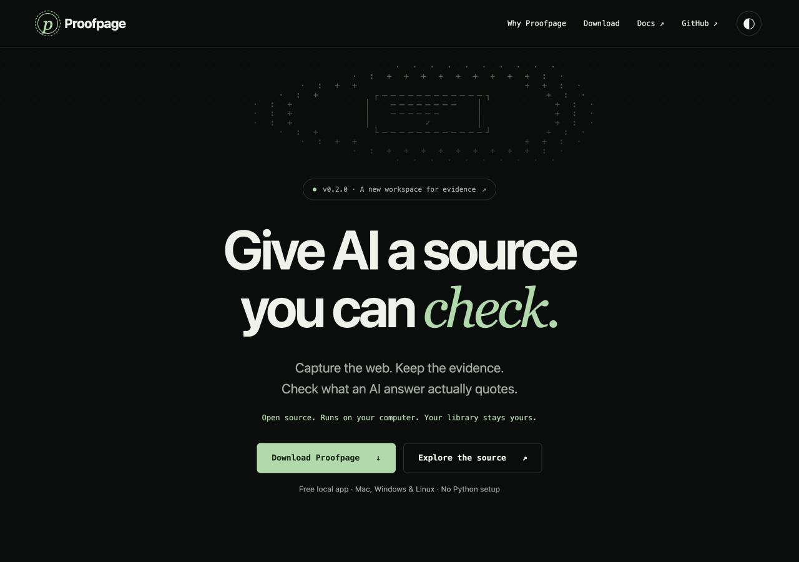

# v0.2.0 delivery verification

- Feature PR #1 merged at `3f7d6a0236c76cc55b344eb68a00a2105ef2a114`; v0.2.0 tags that merge.
- 108 tests passed locally. All 10 jobs passed in application build run 39091698926 and merged-main run 39091993671: Python 3.11/3.13, three guided installers, four native desktop builds, and container smoke checks.
- Both Mac apps were Developer ID signed, Apple-notarized, stapled, and passed local GUI, HTTP, quote-check, offline-verifier, and bundled MCP checks. See [notarization submissions](MAC_NOTARIZATION.md).
- All eight public release assets were downloaded anonymously and their SHA-256 hashes matched the uploaded originals. Both freshly downloaded Mac archives were extracted and independently passed codesign verification, stapler validation, and Gatekeeper assessment.
- Windows signing remains pending; its download page and release notes state this limitation.
- A real static capture replayed in ReplayWeb.page 2.5.3; [scope and reproduction](REPLAY_COMPATIBILITY.md).
- https://proofpage.app serves the new buildless homepage on production Vercel deployment `dpl_Mu28z5jYzc14Z7L4sMsXRN4v65Pp`. Desktop/mobile layout, platform selector, quote demonstration, copy commands, and theme toggle were checked. All four desktop links target the verified v0.2.0 assets.

