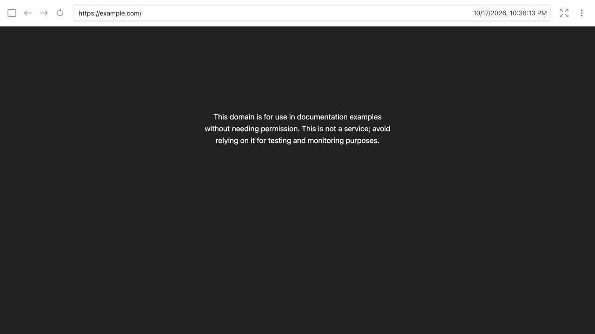

# ReplayWeb.page compatibility

Verified October 18, 2026 UTC with the official `replaywebpage@2.5.3` npm distribution and a WACZ exported from a real Proofpage capture of https://example.com/.

The viewer loaded the archive, showed its recorded capture timestamp, and replayed the captured page text in its archived iframe. The replay URL was served by ReplayWeb.page's local service worker, not the live source. No browser console errors were reported in this check.



## Reproduce

Follow the official [self-hosting instructions](https://replayweb.page/docs/embedding/#self-hosting): serve `ui.js`, `replay/sw.js`, your exported WACZ, and an HTML page over localhost HTTP (or HTTPS). Embed:

```html
<script src="ui.js"></script>
<replay-web-page source="example.wacz" url="https://example.com/"
  loading="eager"></replay-web-page>
```

The earlier public-site file picker was unavailable in the automated browser. Self-hosting the same official viewer removed that transport limitation without changing the WACZ or viewer code.

This checks one static-page replay and complements WARC/WACZ layout, digest and proof-verifier tests. It does not assert that missing assets, interactive JavaScript sites or arbitrary external archives replay fully. Proofpage exports only what it captured; reconstructed legacy content is labeled. Ed25519 receipt sidecars do not claim WACZ-Auth certification.
